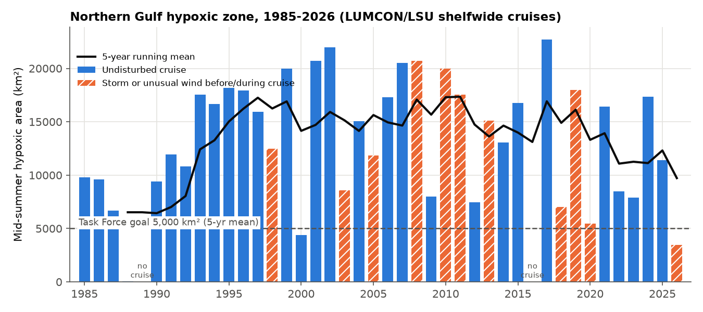
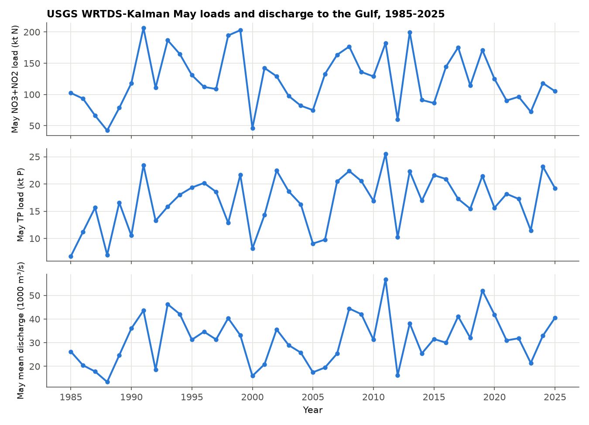
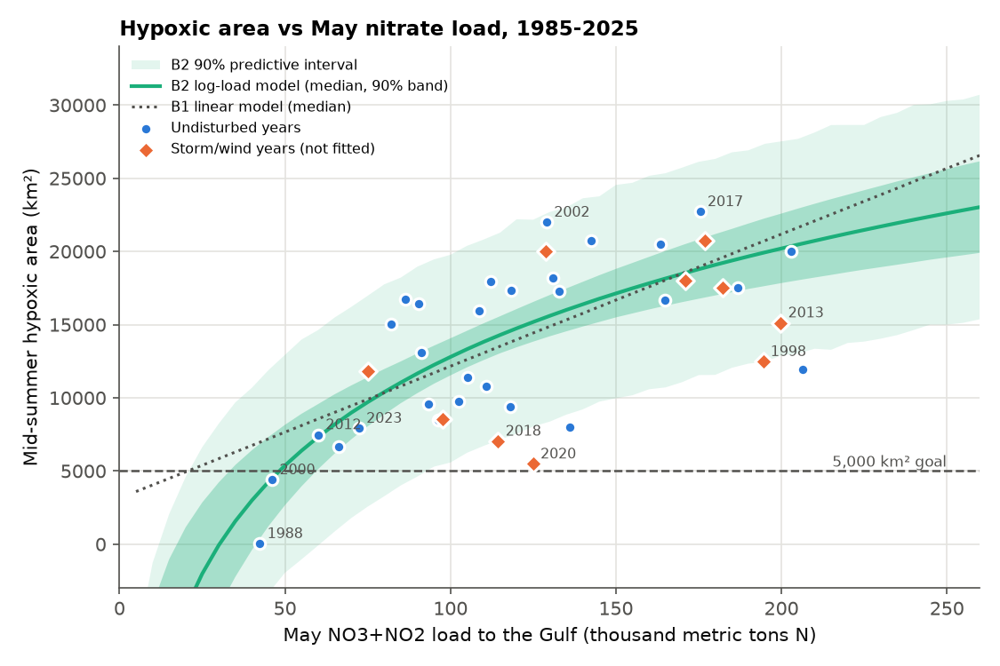
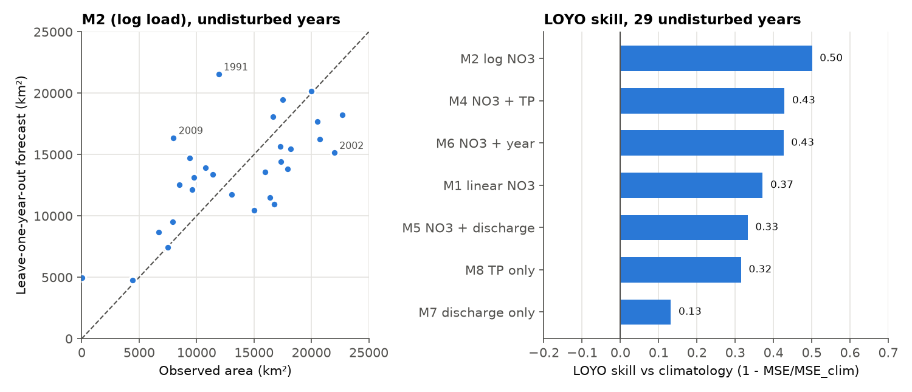
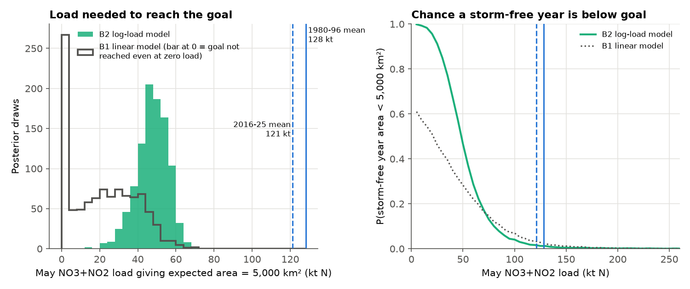
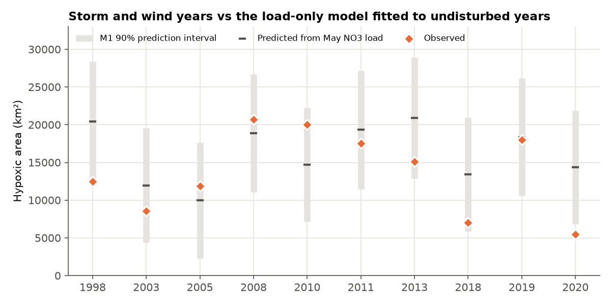

# Gulf hypoxia vs. May nutrient loads: regression, Bayesian model and load-reduction estimate

This repository models the mid-summer hypoxic zone ("dead zone") on the Louisiana-Texas shelf of the northern Gulf of Mexico (Gulf of America) against spring nutrient loads and discharge from the Mississippi and Atchafalaya rivers. The hypoxic area series (1985-2026) was transcribed from LUMCON/LSU shelfwide cruise pages and press releases, then checked three ways. May nitrate+nitrite, total phosphorus and discharge for 1985-2025 come from the USGS WRTDS-Kalman daily output in the USGS Gulf loads data release. I fit ordinary regressions (linear, log, with phosphorus, discharge and a year term) and Bayesian regressions in PyMC. I scored each model by leave-one-year-out (LOYO) cross-validation and estimated the May nitrate load at which the expected storm-free area would fall to the 5,000 km² Hypoxia Task Force goal, with posterior uncertainty. Years in which storms or unusual winds mixed the shelf before the cruise are treated separately and discussed below.

This is an independent analysis of public data. It is separate from my LSU dissertation datasets and uses none of them.

Author: Anamika Dristi, Ph.D.

## Why it matters

The hypoxic zone is the largest recurring low-oxygen area in U.S. coastal waters, and its size is the outcome the Mississippi River/Gulf of America Hypoxia Task Force uses to track nutrient reduction across the basin. The work here touches several things environmental scientist and water-quality roles in Louisiana and Texas deal with: USGS load products, river-to-coast nutrient delivery, transparent handling of a hand-transcribed public record, regression and Bayesian uncertainty, honest out-of-sample testing, and turning a statistical model into a management number (a load target) without overstating it.

## Data sources

All data are public. Raw files are downloaded by `scripts/01_download_data.py` into `data_raw/` (git-ignored). Access date for every source: 2026-10-23.

| Data | Source | ID / link | Records used |
|---|---|---|---|
| Daily WRTDS-Kalman nitrate+nitrite (NO3_NO2), TN and TP flux and daily discharge, Mississippi R. at St. Francisville (STFR, USGS 07373420) and Atchafalaya R. at Melville (MELV, USGS 07381495) | Klager, B.J., 2026, Trends in Nutrient and Other Water Quality Constituent Loads to the Gulf of America from the Mississippi and Atchafalaya Rivers, 1980-2025 (ver. 3.0, May 2026): U.S. Geological Survey data release | ScienceBase item [69fe4aa9b66b01610729c3fd](https://www.sciencebase.gov/catalog/item/69fe4aa9b66b01610729c3fd); earlier versions doi:10.5066/P1MFARP2 and doi:10.5066/P9G0EEUE | `eLists.zip` (EGRET objects), May sums for 1980-2025 (46 Mays), 1985-2025 used in models |
| Published annual Gulf WRTDS-K loads (QA only) | same release, `WRTDS_loads.csv` | same | water years 1981-2025 |
| Mid-summer hypoxic area | LUMCON / LSU shelfwide hypoxia cruises (N.N. Rabalais, R.E. Turner, C. Glaspie; NOAA NCCOS funding) | [gulfhypoxia.net/research/shelfwide-cruises](https://gulfhypoxia.net/research/shelfwide-cruises/), annual press releases (URL per year in `data/hypoxia_area_lumcon.csv`) | 40 cruise years, 1985-2026 (no cruise in 1989 and 2016) |
| Daily discharge, fallback cross-check | USGS NWIS, 07374000 Mississippi R. at Baton Rouge and 07381490 Atchafalaya R. at Simmesport | [waterservices.usgs.gov](https://waterservices.usgs.gov/) | complete Mays 2010-2021, 2024-2025 (14 Mays) |

The EPA Hypoxia Task Force page ([epa.gov/ms-htf/northern-gulf-america-hypoxic-zone](https://www.epa.gov/ms-htf/northern-gulf-america-hypoxic-zone)) shows the area series only inside an embedded Power BI dashboard and links back to LUMCON and NOAA, so the LUMCON/LSU pages were used as the primary record.

### How the hypoxic area series was transcribed and checked

No machine-readable file of the annual areas was found. LUMCON's shelfwide page has two table images (1985-2005 and 2006-2026) and a 1985-2023 bar chart. I found that the 2026 table images disagree with LUMCON's own bar chart and with the original press releases in several years (for example 2008: table 21,764 km², press release 20,720 km²; 2010: table 18,400, press release 20,000). So the series in `data/hypoxia_area_lumcon.csv` was built like this:

1. **Press-release text** wherever one was found (1999-2015, 2017-2026). `scripts/03_verify_hypoxia_transcription.py` confirms that all 27 values appear verbatim in the downloaded release text. Two notes: the 1999 value comes from the 2000 release, and for 2020 the release prints "5,048 square kilometers" next to "2,117 square miles". Since 2,117 mi² is 5,483 km² and both the table and the chart show about 5,480, I used 5,480 km².
2. **The LUMCON table image** for 1985-1998, where no release text was online.
3. **A chart check**: the script digitizes the 1985-2023 bar chart (57.6 km² per pixel; median offset -56 km² against the 24 years that have release text) and compares it with every year. After correction, every value in the series is within 150 km² of the chart. The exception is 1995, where the table (17,220) and the chart (about 18,200) disagree by about 1,000 km². For 1995 I used the digitized chart value, rounded to 18,200, and flagged it as approximate.
4. **Long-term means stated by LSU/LUMCON**: 1985-2020 mean, stated 13,789 km², this series 13,801 (web table 13,700); 38-year mean, stated 13,675, this series 13,669 (web table 13,578); 1985-2011, stated 14,046, this series 13,983.

The column `lumcon_table_km2` keeps the 2026 web-table value for every year, so anyone can rerun the models with it. Using the table values instead changes the main model (M2) very little: slope 10,337 vs 10,430 km² per ln-unit, LOYO skill 0.51 vs 0.50 (`outputs/tables/sensitivity_area_series.csv`).

**Storm and wind flag (`disturbed`)**: 1998, 2003, 2005, 2008, 2010, 2011, 2013, 2018, 2019 and 2020 are flagged. These are the years LSU lists as having "strong storms or unusual wind conditions just before or during the cruise" in its 2022 forecast report. 2026 is also flagged (Tropical Storm Bertha, per the 2026 LSU release). Drought years (1988, 2000, 2012, 2022, 2023) are **not** flagged, because a low load is the signal the models are meant to capture. One exception is 1988: its May load was low, but LUMCON also says July flow dropped and stratification broke down that summer. I ran the models with and without 1988.

## Methods

- **May loads** (`scripts/02_extract_may_loads.R`, base R): I summed the daily WRTDS-Kalman flux (`GenFlux`, kg/day) over May at STFR and MELV and added the two sites to get the Gulf total. The same script averages daily discharge over May. As a QA check, the daily sums reproduce the published annual Gulf WRTDS-K loads to within a ratio of 0.895-0.926 (median 0.907). That is the metric-ton/short-ton factor, 0.9072, so the published `TONS` are short tons and the daily sums agree.
- **Regressions** (`scripts/04_build_dataset_and_regressions.py`, statsmodels OLS), fit on the 29 undisturbed years 1985-2025:
  M1 area ~ NO3; M2 area ~ ln(NO3); M3 ln(area) ~ ln(NO3); M4 area ~ NO3 + TP; M5 area ~ NO3 + discharge; M6 area ~ NO3 + year; M7 area ~ discharge; M8 area ~ TP. All 39 years were also fit with a storm indicator (M9).
- **LOYO cross-validation**: each year is predicted from a model refit without it. Skill = 1 - MSE / MSE of a climatology forecast, where the climatology is the mean of the other years.
- **Bayesian models** (`scripts/05_bayesian_models.py`, PyMC 6.3, NUTS, 4 chains x 2,000 draws, Student-t likelihood): B1 linear and B2 log-load on undisturbed years, and B3 on all years with a multiplicative storm factor, area = (a + bN)(1 - s·D). Approximate LOO comes from PSIS-LOO (ArviZ).
- **Load needed for the goal**: for each posterior draw I solved for the May NO3+NO2 load N\* at which the expected storm-free area equals 5,000 km², then compared N\* with the 1980-1996 mean May load (128.3 kt; the Task Force baseline period) and the 2016-2025 mean (121.3 kt). I also computed the posterior predictive probability that a single storm-free year falls below 5,000 km² as a function of load.

## Key findings

All numbers below come from the run recorded in `outputs/tables/`.

1. **May nitrate load is the strongest single predictor, but it explains about half the variance, not most of it.** In undisturbed years, M2 (area ~ ln NO3) has R² = 0.54 and residual SD of about 3,970 km². Its LOYO RMSE is 4,118 km² and its LOYO skill is 0.50, the best of the eight models. The linear model M1 scores R² 0.44 and LOYO skill 0.37. LSU reports R² of about 0.8-0.9 for its own models. Their models use different load inputs (USGS May loads issued for forecasting, not WRTDS-K), log10 transforms, a year term and other year selections, so these results are not a replication of theirs.
2. **Adding phosphorus or a year term helps a little; discharge does not.** M4 (NO3 + TP): TP coefficient 405 km² per kt (p = 0.04), LOYO skill 0.43. M6 (NO3 + year): +119 km² per year (p = 0.07), LOYO skill 0.43, which is weak evidence that the shelf has become more responsive to a given load. M5 (NO3 + discharge) does no better than M1 (skill 0.33). Discharge alone (M7) has skill 0.13. Nitrate and May discharge are correlated (r = 0.74), so these terms are hard to separate with 29 years.
3. **The log-area model (M3) is a poor forecaster** (LOYO skill -5.2). The cause is 1988 (40 km²): on the log scale 1988 dominates the fit, and back-transformed forecasts for large years blow up. Without 1988, M3 skill is 0.29. M2 remains best without 1988 (skill 0.40).
4. **Storm and wind years are mostly smaller than the load predicts, but not always.** Against M1 fit to undisturbed years, 7 of the 10 disturbed years were below their prediction. The median observed/predicted ratio was 0.82. 2020 (Hurricane Hanna) was the only year below the 90% prediction interval: observed 5,480 km², predicted 14,340. 2008 (Dolly) and 2010 (Alex) came in *above* prediction, and 2019 (Barry) matched it. This fits the LSU and LUMCON description that mixing only resets the zone for days to weeks. B3 estimates the average disturbed-year reduction at s = 0.21 (90% interval 0.08-0.36). Because the flag mixes hurricanes with wind and current events, I report this as a rough average, not a storm effect size.
5. **Reaching 5,000 km² would take a large cut in May nitrate load, and the answer depends on the model's shape.**
   - B2 (log load): N\* = 48 kt (90% interval 33-59 kt), a 62% reduction from the 1980-1996 May mean (90% interval 54-74%) or 60% from the 2016-2025 mean (51-73%).
   - B1 (linear): N\* = 21 kt (90% interval 0-49 kt), an 84% reduction. In 20% of B1 draws the goal is not reached even at zero May load, because the linear intercept stays above 5,000 km².
   - Only three cruise years were ever below 5,000 km²: 1988 and 2000 (May loads of 42 and 46 kt, both droughts) and 2026 (storm year).
   - These May-load reductions are larger than the Task Force's 45% load-reduction target, but they are not directly comparable: that target is for annual total N and P loads, and the goal is a 5-year running mean.
   - At the 2016-2025 mean May load (121 kt), B2 gives about a 1-2% chance that a storm-free year falls below 5,000 km².
6. **Recent context**: the 5-year mean for 2022-2026 is 9,722 km², almost twice the goal. Two of those five years were droughts and 2026 was a storm year, so the low mean is not by itself evidence of lower loads. The 2026 LSU release says the 2026 size reflects physical mixing.

## Figures



*Figure 1. Mid-summer hypoxic area, 1985-2026, with storm or wind years hatched and the 5-year running mean.*



*Figure 2. May nitrate+nitrite and total phosphorus loads and May mean discharge to the Gulf (STFR + MELV, USGS WRTDS-Kalman).*



*Figure 3. Hypoxic area vs May nitrate load with the Bayesian log-load model (B2, fit to undisturbed years) and the linear model (B1).*



*Figure 4. Leave-one-year-out forecasts from M2 and cross-validated skill for each model (M3 left out of the bar chart; its skill is -5.2).*



*Figure 5. Posterior of the May nitrate load giving an expected area of 5,000 km², and the chance a storm-free year falls below the goal at a given load.*



*Figure 6. Observed area in storm or wind years vs the load-only prediction and its 90% prediction interval.*

## Limitations

- **The area series is hand-transcribed.** Public LUMCON sources disagree with each other in some years. I documented every choice, but 1985-1998 rests on one table image plus a chart check, and 1995 is an approximate digitized value. LUMCON notes that cruises sometimes ran out of time, so mapped sizes can understate the true extent (2001 and 2017 were incompletely mapped).
- **The storm flag is coarse.** It follows the LSU 2022 report's list and LSU press releases. It is a yes/no flag with no storm timing, track or intensity. Weather data (wind stress, storm tracks) would be the next step.
- **Load inputs differ from the operational forecasts.** NOAA/LSU forecasts use provisional USGS May loads issued in June. This study uses the later WRTDS-Kalman estimates from the data release, so the fitted coefficients will not match published forecast models.
- **Monthly loads are uncertain.** USGS cautions that monthly flux estimates carry more error than annual ones, and the WRTDS-K output in the release has no confidence intervals. Load error is not propagated into the regressions.
- **The models are simple.** There is no bottom-water temperature, no stratification index, no June load and no wind. The goal calculation is a single-predictor extrapolation toward the low end of the observed loads (the lowest observed May load was 42 kt). It indicates scale and should not be read as a policy target.
- **2026** has an area value but no May load yet (the data release ends in water year 2025), so 2026 is not in any model.
- **NWIS fallback**: the NWIS daily records at 07374000 and 07381490 begin in 2004 and 2009 and have gaps (2022-2023 incomplete), so they could not replace the USACE-based discharge in the data release. Where both exist, May means agree within -5% to +4% (`outputs/tables/nwis_discharge_check.csv`).

## How to run

Requirements: Python 3.11 or newer (the reported run used 3.14) and R 4.x (base only, no packages).

```bash
python -m venv .venv
source .venv/bin/activate
pip install -r requirements.txt
./run_all.sh          # or run scripts/01 ... 06 in order
```

- Step 1 downloads about 120 MB (most of it is the 94 MB `eLists.zip`) into `data_raw/`. Set `GHM_RAW_DIR=/some/path` to keep raw files outside the repo.
- Step 5 sets `PYTENSOR_FLAGS=cxx=` (pure-Python backend) so PyMC runs without a C compiler. It takes under a minute.
- The Bayesian runs use a fixed seed (20261023).

## Repository structure

```
gulf-hypoxia-nutrient-load-model/
  README.md  LICENSE  requirements.txt  run_all.sh  .gitignore
  scripts/
    01_download_data.py                 public downloads (USGS ScienceBase, LUMCON/LSU, NWIS)
    02_extract_may_loads.R              May NO3, TN, TP loads and discharge from WRTDS-K daily output
    03_verify_hypoxia_transcription.py  text, chart and long-term-mean checks of the area series
    04_build_dataset_and_regressions.py OLS models, LOYO cross-validation, storm-year residuals
    05_bayesian_models.py               PyMC models, PSIS-LOO, load needed for 5,000 km2
    06_figures.py                       figures
  data/
    hypoxia_area_lumcon.csv             area series with per-year source URL, web-table value, storm flag
    usgs_may_loads_wrtdsk.csv           May loads and discharge to the Gulf, 1980-2025
    usgs_monthly_loads_wrtdsk.csv       all monthly loads by site (STFR, MELV, GULF)
    model_dataset.csv                   merged modeling table
  outputs/
    figures/                            fig1 ... fig6
    tables/                             model, cross-validation, Bayesian and QA tables
```

## Citation and author

Anamika Dristi, Ph.D. (2026). *Gulf hypoxia vs. May nutrient loads: regression, Bayesian model and load-reduction estimate.* Independent analysis of public USGS and LUMCON/LSU data. Contact: anamikadristi@gmail.com

Data citations:
- Klager, B.J., 2026, Trends in Nutrient and Other Water Quality Constituent Loads to the Gulf of America from the Mississippi and Atchafalaya Rivers, 1980-2025 (ver. 3.0, May 2026): U.S. Geological Survey data release, https://www.sciencebase.gov/catalog/item/69fe4aa9b66b01610729c3fd
- Rabalais, N.N., Turner, R.E., and colleagues, LUMCON/LSU shelfwide hypoxia cruises, https://gulfhypoxia.net/research/shelfwide-cruises/ (supported by NOAA NCCOS); per-year press releases are listed in `data/hypoxia_area_lumcon.csv`.
- U.S. Geological Survey, National Water Information System, https://waterservices.usgs.gov/

Related published work by the author, for context on Louisiana river and estuary biogeochemistry: Dristi & Xu 2023, *Water* 15(14):2621; Dristi & Xu 2025, *Water* 17(17):2589; Dristi et al. 2025, *Estuarine, Coastal and Shelf Science* 324:109465.
